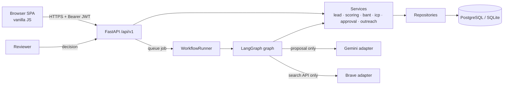
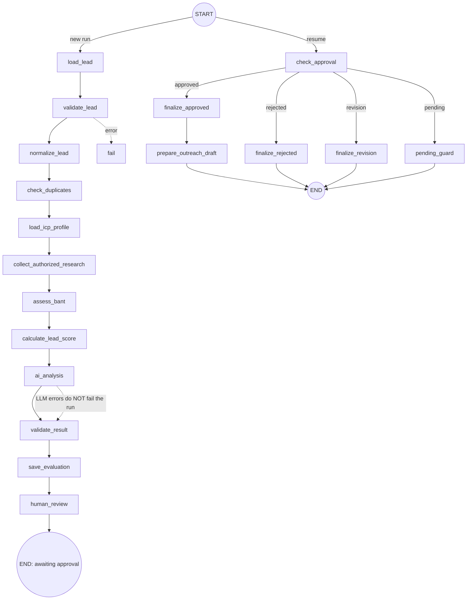
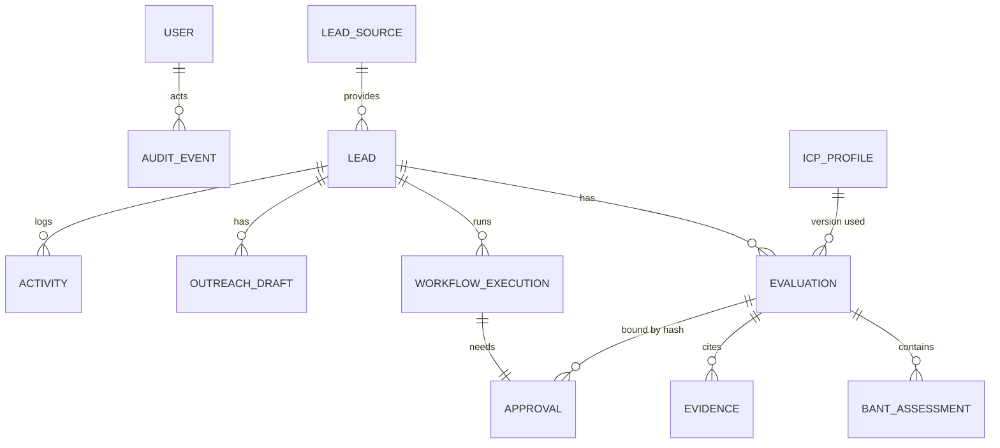

# Architecture

## 1. Problem & MVP
Sales teams waste time on poor-fit leads and cannot explain why a lead is "hot". This app gives every lead a reproducible,
explainable score + BANT picture, adds an AI *proposal* layer, and forces a human decision before consequential actions.

**MVP (built):** lead intake, normalisation/dedup, versioned ICP, deterministic scoring, BANT, Gemini proposal, LangGraph workflow,
approval queue, draft outreach, dashboard, audit trail, tests, Docker.
**Later:** email sending (with suppression list + idempotency), CRM sync, queue/worker, multi-tenancy, SSO, embeddings (only if measured value).

## 2. System diagram


## 3. Data flow (qualification)
`POST /leads/{id}/qualify` → execution row `queued` (partial unique index = max one active per lead) → background run →
nodes persist state/trace after every step → **`human_review` creates a pending Approval and parks the run** →
reviewer `POST /approvals/{id}/decision` (atomic compare-and-set) → `resume()` re-enters the graph at `check_approval`
which **re-reads the decision from the DB** → `finalize_*` → approval-gated draft tool → END.

## 4. LangGraph design
State (`app/agents/state.py`) holds ids and small facts only; ORM objects live in a per-run scratch dict.

* Deterministic nodes (validate, normalise, dedupe, BANT, score) are plain Python. Only `ai_analysis` calls an LLM.
* Bounded: step budget (30), `recursion_limit`, LLM retries ≤ `LLM_MAX_RETRIES`, timeouts on every external call.
* Failure → `fail` node closes the execution and returns the lead to `new`. Stale `running` rows are recovered at startup.
* Why not LangGraph `interrupt`/checkpointer? Persisting our own `WorkflowExecution.state` keeps one storage engine (SQLite or Postgres),
  makes the pause visible/queryable in SQL, and lets approval be a *separate authenticated HTTP action*.

## 5. Entities

Evaluations are **immutable**; recalculation adds rows. ICP edits create a **new version** (old rows untouched).
Each approval stores the evaluation `payload_hash`; if the result changes after review was requested, the decision fails closed.

## 6. Scoring rules (engine `scoring-v1`)
| Criterion | Full | Partial | Not matched | Unknown (0 pts) |
|---|---|---|---|---|
| Industry | in target list | – | other industry | blank |
| Company | size in range *and* location targeted | near range (±50%) / one of two | outside | both blank |
| Need | ≥2 keyword hits | 1 hit (0.6) | text but no hit | no text |
| Decision maker | flag=yes or relevant title | unknown title (0.3) | flag=no | none |
| Budget | ≥ minimum | 50–99% (0.5) | <50% | blank |
| Timeline | immediate / ≤3 mo | 6 mo (0.6), exploring (0.2) | – | blank |
| Evidence quality | ≥85% | scaled | – | no fields |

Weights are normalised to 100. Disqualification needs **explicit** data (opt-out, excluded industry/country, budget below hard minimum).
Defaults 80/50 are configurable starting points, **not** benchmarks and **not** conversion probabilities.

## 7. API (all under `/api/v1`)
`GET /health` · `GET /ready` · `POST /auth/login|logout` · `GET /auth/me` · `GET|POST /users` (admin) ·
`GET|POST /leads` · `GET|PATCH /leads/{id}` · `GET /leads/{id}/detail` · `POST /leads/{id}/archive|restore|merge` ·
`POST /leads/import` · `GET /leads/import/template` · `POST /leads/{id}/score` · `GET /leads/{id}/evaluations` ·
`POST /leads/{id}/qualify` (202) · `GET /workflows/{id}` · `GET /leads/{id}/workflows` ·
`GET /approvals` · `POST /approvals/{id}/decision` · `GET|PUT /icp` · `GET /icp/versions|criteria` · `POST /icp/recalculate` ·
`POST /leads/{id}/drafts` · `GET /drafts` · `PATCH /drafts/{id}` · `POST /drafts/{id}/mark-sent` ·
`GET /dashboard/stats|reports`. Errors use one envelope: `{"error":{"code","message","details","request_id"}}`.

## 8. Folder structure
```
app/ api/ (dependencies, v1/endpoints)  core/ (config, security, logging, exceptions)  db/  models/  schemas/
     repositories/  services/ (pure domain logic + orchestration)  agents/ (state, graph, nodes, prompts, tools)
     integrations/ (gemini, web_search)  workers/ (runner)  static/ (css, js, pages)
alembic/  tests/ (unit, api, integration, security, workflows)  scripts/  docs/  data/
```
Not created because not implemented: `integrations/email`, `integrations/crm` (no empty placeholders by design).

## 9. Decisions (ADR summary)
| Decision | Why | Trade-off |
|---|---|---|
| Deterministic scoring, LLM proposes | explainable, reproducible, injection cannot move the score | less "magic" |
| Own persisted state instead of LangGraph checkpointer | single DB, SQL-visible pause | manual resume code |
| Partial unique index per lead | race-safe duplicate protection in the DB | needs index support (SQLite/Postgres both OK) |
| Bearer JWT, role read from DB each request | revocation/demotion immediate | one DB read per request |
| Draft-only outreach | no legal/deliverability risk in v1 | manual send |
| BackgroundTasks | zero infra | not durable; see limitations |
